# Abhiyukth Vlogs - Official Channel Website

A modern, responsive, high-performance website for the YouTube channel **Abhiyukth Vlogs** (`@abhiyukthvlogs`), featuring an interactive Three.js 3D hero (PS5 DualSense controller & cinematic camera), verified Malayalam video highlights, livestream replays, and playlist showcase.

---

## 🎮 Highlights & Architecture

```mermaid
flowchart TD

subgraph group_client["Channel Website"]
  node_app["App Orchestrator<br/>[main.js]"]
end

subgraph group_content["Channel Content"]
  node_channel["Channel Configuration<br/>[channel.js]"]
  node_featured["Featured Video<br/>[main.js]"]
  node_shorts["YouTube Shorts Feed<br/>[shortsSection.js]"]
  node_catalog["Video Catalog<br/>[main.js]"]
  node_live["Live Stream Card<br/>[liveSection.js]"]
  node_playlists["Playlist Showcase<br/>[main.js]"]
  node_profile["Channel Profile<br/>[main.js]"]
  node_social["Social Links<br/>[channel.js]"]
end

subgraph group_interaction["Interactive Features"]
  node_modal["Video Modal<br/>[videoModal.js]"]
  node_youtube["YouTube Player (16:9 & 9:16)"]
  node_hero["3D Hero Scene<br/>[scene.js]"]
  node_odometer["Subscriber Odometer<br/>[odometer.js]"]
end

subgraph group_stats["Backend & Serverless API"]
  node_express["Express Backend Server<br/>[server.js]"]
  node_vercel["Vercel Serverless Functions<br/>[api/live.js, api/shorts.js, api/subscribers.js]"]
  node_shorts_svc["Shorts & Live Discovery Engines<br/>[api/_lib/youtubeLive.js, youtubeShorts.js]"]
  node_youtube_api["YouTube Data API v3 & Live Streaming"]
end

node_visitor(("Visitor"))

node_visitor -->|"browses"| node_app
node_app -->|"reads content"| node_channel
node_app -->|"renders"| node_featured
node_app -->|"renders 9:16 feed"| node_shorts
node_app -->|"renders and filters"| node_catalog
node_app -->|"renders live card"| node_live
node_app -->|"renders"| node_playlists
node_app -->|"renders"| node_profile
node_app -->|"uses links"| node_social
node_live -->|"fetches live / replay"| node_express
node_live -->|"fetches live / replay"| node_vercel
node_shorts -->|"fetches live / cached"| node_express
node_shorts -->|"fetches live / cached"| node_vercel
node_app -->|"opens 16:9 & 9:16 modal"| node_modal
node_modal -->|"embeds on demand"| node_youtube
node_app -->|"loads dynamically"| node_hero
node_app -->|"updates"| node_odometer
node_express -->|"discovers streams"| node_shorts_svc
node_vercel -->|"discovers streams"| node_shorts_svc
node_shorts_svc -->|"discovers & verifies"| node_youtube_api
node_express -->|"fetches statistics"| node_youtube_api
node_vercel -->|"fetches statistics"| node_youtube_api

click node_app "https://github.com/abhiyukth-vlogs/abhiyukth.github.io/blob/main/src/main.js"
click node_channel "https://github.com/abhiyukth-vlogs/abhiyukth.github.io/blob/main/src/data/channel.js"
click node_featured "https://github.com/abhiyukth-vlogs/abhiyukth.github.io/blob/main/src/main.js"
click node_catalog "https://github.com/abhiyukth-vlogs/abhiyukth.github.io/blob/main/src/main.js"
click node_live "https://github.com/abhiyukth-vlogs/abhiyukth.github.io/blob/main/src/main.js"
click node_playlists "https://github.com/abhiyukth-vlogs/abhiyukth.github.io/blob/main/src/main.js"
click node_profile "https://github.com/abhiyukth-vlogs/abhiyukth.github.io/blob/main/src/main.js"
click node_social "https://github.com/abhiyukth-vlogs/abhiyukth.github.io/blob/main/src/data/channel.js"
click node_modal "https://github.com/abhiyukth-vlogs/abhiyukth.github.io/blob/main/src/components/videoModal.js"
click node_hero "https://github.com/abhiyukth-vlogs/abhiyukth.github.io/blob/main/src/scene.js"
click node_odometer "https://github.com/abhiyukth-vlogs/abhiyukth.github.io/blob/main/src/components/odometer.js"
click node_express "https://github.com/abhiyukth-vlogs/abhiyukth.github.io/blob/main/server.js"
click node_vercel "https://github.com/abhiyukth-vlogs/abhiyukth.github.io/blob/main/api/subscribers.js"

classDef toneNeutral fill:#f8fafc,stroke:#334155,stroke-width:1.5px,color:#0f172a
classDef toneBlue fill:#dbeafe,stroke:#2563eb,stroke-width:1.5px,color:#172554
classDef toneAmber fill:#fef3c7,stroke:#d97706,stroke-width:1.5px,color:#78350f
classDef toneMint fill:#dcfce7,stroke:#16a34a,stroke-width:1.5px,color:#14532d
classDef toneRose fill:#ffe4e6,stroke:#e11d48,stroke-width:1.5px,color:#881337
classDef toneIndigo fill:#e0e7ff,stroke:#4f46e5,stroke-width:1.5px,color:#312e81
classDef toneTeal fill:#ccfbf1,stroke:#0f766e,stroke-width:1.5px,color:#134e4a
class node_app toneBlue
class node_channel,node_featured,node_catalog,node_live,node_playlists,node_profile,node_social toneAmber
class node_modal,node_youtube,node_hero,node_odometer toneMint
class node_express,node_vercel,node_youtube_api toneRose
class node_visitor toneIndigo
```



- **Interactive 3D Hero (Three.js)**:
  - Procedurally generated modern PS5 DualSense controller and stylized camera (no external 3D model assets to fail or slow down loading).
  - Mode toggle: **Gaming** vs **Vlogs** transitions focal objects, rotation, and neon lighting.
  - Orbital rings, floating 3D play symbol, and ambient particle dust field.
  - Pointer parallax with inertia and smooth touch-safe drag-to-rotate (`touch-action: pan-y`).
  - Motion pause control and automatic `prefers-reduced-motion` compliance.
  - Intelligent lifecycle: pauses rendering when offscreen or when browser tab is hidden.
  - Accessible WebGL fallback with SVG monogram.
- **Single Source of Truth Configuration**:
  - `src/data/channel.js` contains all verified channel identity, statistics, videos, playlists, and external links.
- **Verified Channel Content**:
  - Direct information from `@abhiyukthvlogs`: real subscriber count (5.7K+), total uploads (608+), 2.3M+ views, real Malayalam video titles, verified stream replays (*Ghost of Tsushima Director's Cut PS5*), and playlist collections.
- **Accessible Video Modal**:
  - Lazy-loads YouTube iframe embeds only on click.
  - Keyboard trap, `Escape` key close, focus restoration to trigger element, and immediate iframe removal to cease audio playback.
  - "Watch on YouTube" fallback link.
- **Responsive Layout**:
  - Tested across Desktop (1440px), Tablet (768px), and Mobile (390px) viewports with zero horizontal overflow.
- **Automated GitHub Pages Deployment**:
  - Configured with `vite.config.js` (`base: '/'`) and GitHub Actions workflow (`.github/workflows/deploy.yml`).

---

## 🛠️ Project Structure

```
├── .github/
│   └── workflows/
│       └── deploy.yml          # GitHub Actions workflow for automatic Pages deployment
├── public/
│   ├── assets/
│   │   └── avatar-fallback.svg # Geometric AV Monogram fallback avatar
│   └── favicon.svg             # SVG favicon with AV monogram & play emblem
├── src/
│   ├── components/
│   │   └── videoModal.js       # Accessible modal dialog with focus trap & lazy iframe
│   ├── data/
│   │   └── channel.js          # Channel profile, stats, verified videos & playlists
│   ├── main.js                 # App orchestrator, filters, search, drawer, & dynamic import
│   ├── scene.js                # Three.js 3D Hero scene engine (DualSense, camera, rings)
│   └── styles.css              # Vanilla CSS design system (Dark theme, tokens, responsive)
├── index.html                  # Semantic HTML5, SEO meta tags, OpenGraph, JSON-LD Schema
├── package.json                # Dependencies and npm scripts
├── vite.config.js              # Vite configuration with chunk splitting & base: '/'
└── README.md                   # Documentation and usage guide
```

---

## 🚀 Quick Start & Local Development

### 1. Prerequisites
Ensure **Node.js** (v18 or higher) and **npm** are installed:
```bash
node -v
npm -v
```

### 2. Install Dependencies
```bash
npm install
```

### 3. Run Local Dev Server
```bash
npm run dev
```
Open [http://localhost:5173/](http://localhost:5173/) in your browser.

### 4. Build for Production
```bash
npm run build
```
The compiled bundle will be generated in `dist/`.

### 5. Preview Production Build
```bash
npm run preview
```

---

## 🌐 GitHub Pages Auto-Deployment

The repository is configured to deploy directly to `https://abhiyukth.github.io/` via GitHub Actions:

1. **Vite Base Path**:
   In `vite.config.js`, `base: '/'` is set for root domain hosting on `abhiyukth.github.io`.

2. **GitHub Actions Workflow**:
   `.github/workflows/deploy.yml` triggers automatically on pushes to the `main` branch:
   - Checks out the repository
   - Sets up Node.js 20
   - Runs `npm ci` and `npm run build`
   - Deploys the `dist/` directory to GitHub Pages

3. **Enabling GitHub Pages in Repository Settings**:
   - Go to **Repository Settings** > **Pages**.
   - Under **Build and deployment** > **Source**, select **GitHub Actions**.
   - Every push to `main` will build and publish automatically.

---

## ⚙️ Content & Customization Guide

### How to Edit Channel Data & Social Links
Open [`src/data/channel.js`](file:///e:/abhiyukth.github.io/src/data/channel.js):
- **Channel Identity**: Edit `channel.name`, `channel.handle`, `channel.bio`, and `channel.stats`.
- **Milestones**: Update `channel.milestones` subscriber goals.
- **Social Links**: Update `links.youtube`, `links.instagram`, `links.kick`, `links.twitch`, `links.x`, and donation links.

### How to Replace the Avatar & Banner
1. Place your new profile picture in `public/assets/avatar.jpg` (or provide a direct URL).
2. In `src/data/channel.js`, update:
   ```javascript
   avatarUrl: '/assets/avatar.jpg',
   ```
3. In `index.html`, update the `src` attribute of the header `.brand-avatar` and about `.about-avatar-img`.

### How to Add Verified Videos
In `src/data/channel.js`, add new items to the `videos` array:
```javascript
{
  id: 'YOUTUBE_VIDEO_ID',
  title: 'Your Malayalam or English Video Title',
  category: 'Gaming', // 'Gaming' | 'Vlogs' | 'Live Replays'
  views: '1.2K views',
  timeAgo: '1w ago',
  duration: 'PS5 Live',
  thumbnail: 'https://i.ytimg.com/vi/YOUTUBE_VIDEO_ID/hq720.jpg'
}
```

### 📱 YouTube Shorts Auto-Updating Feed & Classification
The website features an automated YouTube Shorts synchronization pipeline that automatically surfaces new public Shorts from [@abhiyukthvlogs](https://www.youtube.com/@abhiyukthvlogs) without manual video ID additions or redeployments:

1. **Automatic Discovery Engine**:
   - Endpoint: `/api/youtube/shorts` and `/api/shorts` (Express `server.js` and Vercel serverless functions).
   - Resolves uploads playlist (`UUuG7-r1F3b2RzGoRFIe0MnQ`) from `@abhiyukthvlogs`.
   - Discovers new uploads via `playlistItems.list` and batches details via `videos.list`.
   - Filters only public, processed videos belonging strictly to `@abhiyukthvlogs`.
2. **Accurate Multi-Layer Classification**:
   - **Public Route Verification**: Checks candidate videos against `https://www.youtube.com/shorts/${id}` with redirect inspection (HTTP 200 = True Short; HTTP 302/303 redirect to `/watch?v=` = Landscape video, accurately excluded).
   - **Upload-Date Rules & Duration**: Enforces YouTube upload-date rules (≤60s prior to Oct 15, 2024; ≤180s for uploads after Oct 15, 2024 with vertical/square orientation).
   - **Owner OAuth (Optional)**: Connects to YouTube Analytics (`creatorContentType=SHORTS`) and inspects authenticated `fileDetails.videoStreams[0]` aspect ratio (vertical: `height >= width`).
3. **Resilience & Caching**:
   - Shared 5-minute freshness interval (`s-maxage=300, stale-while-revalidate=600`).
   - Serves cached responses across visitors to conserve YouTube API quotas.
   - During temporary API limits or network issues, serves stale cache or the bundled verified channel snapshot. The website never breaks.
4. **Interactive Playback**:
   - 9:16 portrait cards with original Malayalam titles, duration pill, and YouTube view counts.
   - Dedicated 9:16 portrait modal player with responsive vertical YouTube embed and "Watch on YouTube" fallback.
   - Swipeable carousel on phones and 4-column responsive grid on desktop.

### 🔑 Connecting Channel Owner OAuth (One-Time Setup)
While the site works out-of-the-box with public YouTube Data API discovery and route verification, channel owners can optionally connect OAuth for exact `fileDetails` and YouTube Analytics report integration:

1. Create an OAuth 2.0 Client ID in [Google Cloud Console](https://console.cloud.google.com/apis/credentials) with Authorized Redirect URI:
   - `http://localhost:5000/api/auth/youtube/callback` (or your production Vercel domain URL)
2. Add the client ID and secret to your `.env` file:
   ```bash
   YOUTUBE_CLIENT_ID=your_oauth_client_id
   YOUTUBE_CLIENT_SECRET=your_oauth_client_secret
   YOUTUBE_REDIRECT_URI=http://localhost:5000/api/auth/youtube/callback
   ```
3. Visit `http://localhost:5000/api/auth/youtube` in your browser and authorize the read-only scopes.
4. The callback page will display your `YOUTUBE_REFRESH_TOKEN`. Save it into `.env` to keep authenticated sync permanently active!


### How to Add Playlists
In `src/data/channel.js`, add items to `playlists`:
```javascript
{
  id: 'PLAYLIST_ID',
  title: 'Series Name',
  videoCount: '12 videos',
  category: 'Travel Series',
  url: 'https://www.youtube.com/playlist?list=PLAYLIST_ID',
  thumbnail: 'https://i.ytimg.com/vi/VIDEO_ID/hqdefault.jpg'
}
```

### Dynamic Live Stream Auto-Updating
The Live Stream card automatically detects active YouTube broadcasts without manual code changes or redeployments:

- **Active Live Broadcast**: When you start a public livestream on `@abhiyukthvlogs`, the card automatically switches to that stream, applies the pulsing **LIVE NOW** badge, displays the exact YouTube title (including Malayalam text), updates the thumbnail, and sets the **Watch Live Now** modal/player destination.
- **Completed Stream Replay**: When the broadcast ends, the card automatically transitions to **Latest Live Replay**, showing the latest available completed public livestream.
- **Multiple Active Broadcasts**: If multiple streams are active, the system automatically selects the most recently started one.
- **Scheduled Streams**: Upcoming broadcasts are kept as reminders and never shown as active before they actually start.
- **Flicker-Free Periodic Sync**: The card refreshes in-place every 90 seconds while visible and immediately when returning to the tab.
- **API Endpoint**: Served by `/api/youtube/live` (and `/api/live`), featuring server-side request deduplication, a 90-second cache for live status, and a 10-minute cache for replays.

#### Quota & Owner Authorization Setup
1. **Public API Key Fallback**:
   Uses YouTube Data API v3 (`search.list` with `eventType=live`). Because `search.list` costs 100 quota units, shared server-side caching (90s TTL) and in-flight request deduplication are applied so multiple visitors share a single request.
2. **Owner-Authorized Discovery (Recommended - 1 Quota Unit)**:
   Uses `liveBroadcasts.list` (broadcastStatus=active, broadcastType=all), which costs only **1 quota unit** (vs 100).
   To enable owner authorization:
   1. In [Google Cloud Console](https://console.cloud.google.com/apis/credentials), create an **OAuth 2.0 Client ID** (Web Application).
   2. Set Authorized Redirect URI: `http://localhost:5000/api/auth/youtube/callback` (or your domain's callback).
   3. Add `YOUTUBE_CLIENT_ID` and `YOUTUBE_CLIENT_SECRET` to your `.env` file.
   4. Start the server (`npm run server`) and visit `http://localhost:5000/api/auth/youtube`.
   5. Grant read-only YouTube permission (`youtube.readonly`).
   6. Copy the generated `YOUTUBE_REFRESH_TOKEN` into your `.env` file.

### How to Adjust Color Palette & Theme Tokens
Open [`src/styles.css`](file:///e:/abhiyukth.github.io/src/styles.css) and customize `:root`:
```css
:root {
  --bg-color: #070911;          /* Deepest space navy */
  --surface-color: #111525;     /* Card surface */
  --surface-hover: #181E34;     /* Hover surface */
  --text-main: #F5F7FF;         /* Primary text */
  --text-secondary: #A7B0C0;    /* Secondary text */
  --accent-purple: #8B5CF6;     /* Purple accent */
  --accent-cyan: #22D3EE;       /* Cyan accent */
  --yt-red: #FF0033;            /* YouTube red */
}
```

---

## 🔍 Verified Content Summary

| Category | Content Verified from `@abhiyukthvlogs` | Status |
| :--- | :--- | :--- |
| **Channel Name** | `Abhiyukth Vlogs` | Verified |
| **Handle** | `@abhiyukthvlogs` | Verified |
| **Subscribers** | `5.7K+ subscribers` | Verified |
| **Upload Count** | `608+ videos` | Verified |
| **Total Views** | `2,349,939 views` | Verified |
| **Joined Date** | `Feb 15, 2021` | Verified |
| **Country** | `India` (Kerala) | Verified |
| **Avatar & Artwork** | Original channel avatar & YouTube banner | Verified |
| **Featured Video** | Kozhikode Walkaaro Walkathon 2026 (`gxpAlDUWIOQ`) | Verified |
| **Live Stream Replay**| *IRL Ghost Of Tsushima Director's Cut: Live Ps5* (`Kw2kIt6dyU4`) | Verified |
| **Featured Playlists**| *Ghost Of Tsushima*, *PS5 Live*, *Kozhikode to Kashmir*, *GTA V*, *BGMI Live*, *Komban Holidays* | Verified |
| **Social Links** | YouTube Channel, Streams tab, Playlists tab, Instagram (`@abhiyukth.vlogs`), Kick, Twitch, X | Verified |
| **Active Live Broadcast** | Currently Offline / Showing Latest Verified Stream Replay | Verified |

---

## 🧪 Verification & Automated Testing

The website has been verified with an automated end-to-end test suite:
- **Responsive Viewports**: Tested at `1440px` (Desktop), `768px` (Tablet), and `390px` (Mobile) with `0px` horizontal overflow (`bodyScrollWidth === innerWidth`).
- **Interactive 3D Hero**: Tested mode transitions ("Gaming" vs "Vlogs"), motion pause/resume toggle, and cursor parallax.
- **Featured Video Modal**: Tested modal opening, 16:9 iframe embedding, focus trapping, Escape key closing, and playback stopping.
- **Search & Filters**: Real-time title search, category switching (Gaming, Vlogs, Live Replays), and empty state handling.
- **Mobile Menu**: Verified drawer toggle, focus accessibility, and seamless link navigation.
